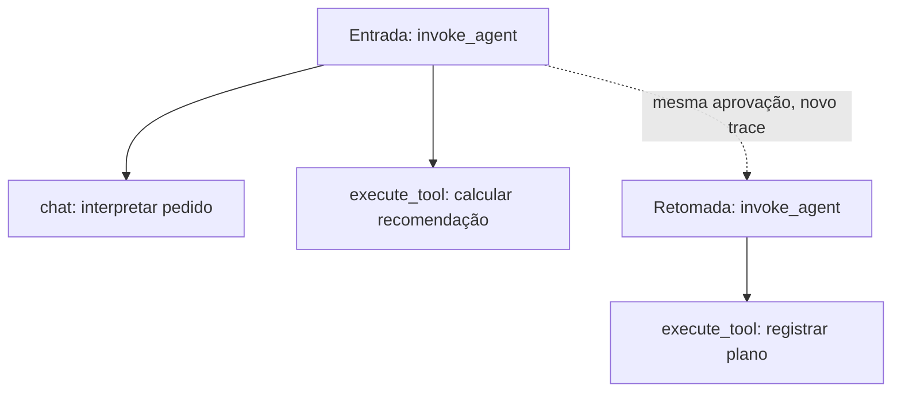

# Plano e resultados de observabilidade — Pastéis Miyata

O plano v1.0 definiu as metas antes da coleta. Os resultados abaixo se referem à versão `obs-v1-9393b1db60fb` na coorte `avaliacao`.

## 1. Perguntas de observabilidade

| Interessado | Pergunta | Sinal | Decisão apoiada |
|---|---|---|---|
| Negócio | As execuções terminam de forma utilizável? | SLI de qualidade, motivos de término, normalizações e erros | Manter o uso supervisionado ou voltar temporariamente ao processo manual |
| Operação | A demora está no modelo, nas ferramentas ou na espera por aprovação? | p50 e p95 da raiz e dos filhos; espera medida separadamente | Escolher o componente a investigar primeiro |
| Quem paga | Quanto custa cada execução e quantas ultrapassam o limiar? | Tokens, preços configurados e custo estimado por raiz | Rever contexto, repetição de chamadas ou orçamento |
| Quem responde pelo sistema | É possível explicar por que uma regra foi aplicada ou um plano registrado? | Documento recuperado, resultado da ferramenta, versão e eventos correlacionados | Localizar a evidência da decisão e verificar a autorização |

## 2. Trace de uma execução

Cada chamada a `AgentePlanejamento.executar` ou `AgentePlanejamento.retomar` produz uma raiz. Uma pausa encerra a raiz atual; a retomada abre outro trace com o mesmo `pasteis.aprovacao.id`. A espera entre solicitação e decisão não entra na latência do agente.

A árvore é ilustrativa. Uma rota determinística pode abrir um span de ferramenta sem chamar o modelo.

| Span | Ponto de instrumentação | Dados |
|---|---|---|
| `invoke_agent pasteis-miyata` | Fachada em `src/agent.py` | Versão, coorte, tipo de execução, latência, motivo de término, estado da saída, custo e eventos |
| `chat <modelo>` | Chamada ao provedor em `src/graph.py` | Modelo solicitado/retornado, tokens de entrada e saída, custo e tipo de erro |
| `execute_tool <ferramenta>` | Executor, rotas do corpus ou tentativa de registro após aprovação | Nome, duração, argumentos e resultado selecionados e desfecho |

A exportação está em [`src/observabilidade.py`](../src/observabilidade.py). Bloqueios anteriores à execução são eventos, não spans de ferramenta. A pausa para aprovação também não conta como tentativa de escrita.

### Atributos da raiz

| Atributo | Uso |
|---|---|
| `pasteis.sistema.versao`, `service.version` | Separar as medições por versão |
| `pasteis.modelo.configurado` | Identificar o modelo configurado sem presumir chamada |
| `pasteis.prompt.orquestrador.versao`, `pasteis.prompt.procedimento.versao` e seus hashes | Identificar os prompts sem copiar o texto |
| `pasteis.execucao.tipo`, `pasteis.execucao.coorte` | Distinguir entrada, retomada, avaliação, operação e teste |
| `pasteis.execucao.motivo_termino`, `pasteis.execucao.categoria_termino` | Identificar conclusão, pedido de informação, recusa, pausa, erros e demais motivos |
| `pasteis.execucao.latencia_ms` | Medir processamento sem a espera pela decisão |
| `pasteis.execucao.custo_estimado_usd`, `pasteis.execucao.custo_completo` | Medir custo sem converter uso desconhecido em zero |
| `pasteis.execucao.erros_tecnicos`, `pasteis.saida.status`, `pasteis.saida.suficiente`, `pasteis.saida.normalizada` | Calcular a qualidade de término |
| `pasteis.aprovacao.id` | Vincular solicitação, decisão e tentativa de registro |

### Dados e acesso

O trace registra campos estruturados, identificadores opacos, referências recuperadas e desfechos de ferramentas. Não copia prompts, mensagens livres, credenciais ou linhas completas do MySQL. Os eventos `aprovacao.solicitada`, `aprovacao.decidida` e `aprovacao.escrita` ajudam a reconstruir a decisão; não são mecanismos de autorização.

A exportação é local em JSONL em `logs/traces/`, sem coletor remoto. Os traces brutos não entram no Git. O [guia de uso](uso_traces.md) mostra como gerar e ler os arquivos. A retenção de até 30 dias é proposta, sem exclusão automática.

Na coorte `teste`, a pergunta “Sobra zero prova que faltou produto?” retornou `prova_falta=false`, com um `invoke_agent` e um `execute_tool buscar_conhecimento` que apontou para `glossario_dados_v1`. Não houve MySQL nem chamada ao modelo. Essa demonstração não entra nos indicadores da coorte `avaliacao`.

## 3. Modos de falha

| Falha | Visibilidade | Sinal |
|---|---|---|
| Falha ou tempo excedido no provedor | Ruidosa | `error.type` no `chat` e motivo associado na raiz |
| Erro ao consultar MySQL | Ruidosa | `pasteis.ferramenta.desfecho=erro_tecnico`, distinto de `sem_dados` |
| Esgotamento de passos, tokens, tempo ou custo | Silenciosa para quem monitora apenas exceções | Categoria `orcamento_esgotado` e código `LIMITE_DE_*` |
| JSON do modelo inválido, posteriormente normalizado | Silenciosa para quem verifica apenas o formato final | `pasteis.saida.normalizada=true` |
| Aprovação pendente além do prazo | Silenciosa sem correlação dos eventos | Solicitação sem decisão após `pasteis.aprovacao.expira_em`, ou expiração registrada |

## 4. Objetivos e método de medição

| Objetivo | Meta | Janela e amostra mínima |
|---|---|---|
| Latência | p95 de `pasteis.execucao.latencia_ms` ≤ 15.000 ms | Sete dias, mesma versão e coorte, pelo menos 30 raízes |
| Qualidade de término | SLI ≥ 95% | Sete dias, mesma versão e coorte, pelo menos 30 execuções elegíveis |

### 4.1. Definição do SLI de qualidade

`N` é o número de raízes encerradas na janela, da mesma versão e coorte. Excluem-se somente a pausa legítima (`aguardando_humano` com evento `aprovacao.solicitada`) e o cancelamento explícito (`interrompido`). Erros, bloqueios, laços, limites esgotados e términos indeterminados continuam no denominador.

`B` inclui as execuções válidas em uma destas condições:

- `respondeu`, com `status=concluido` e `suficiente=true`;
- `pediu_esclarecimento`, com `status=precisa_informacao`;
- `recusou`, com `status=recusado`.

Nas três condições, exige-se `normalizada=false` e `erros_tecnicos=0`. Uma recusa ou um pedido de esclarecimento apropriado é um bom término. Isso não mede a correção de toda afirmação da resposta.

- SLI: `100 × B / N`.
- Orçamento de erro: `0,05 × N`, com no máximo `floor(0,05 × N)` execuções ruins sem violar a meta.
- Consumo do orçamento: `100 × (N − B) / (0,05 × N)`.

A conciliação exige uma raiz por etapa executada no `resultado.json` e confronta os spans de modelo com o contador da raiz. Ausência ou duplicidade invalida a cobertura.

### 4.2. Coleta e cobertura

Foram duas rodadas dos mesmos 20 casos do dataset `1.0.0`, com `gpt-5.6-luna` e MySQL local somente leitura no snapshot `c7f695afd8f7` (138 operações e 3.634 registros). Os hashes completos de código, dataset e snapshot coincidiram.

Os términos observados ocorreram em **18/11/2026, de 21:51:10 a 21:56:40**, no fuso de São Paulo. A coleta durou cerca de cinco minutos e meio, dentro da janela móvel de sete dias; não houve monitoramento contínuo por sete dias. Os arquivos têm carimbo UTC.

| Rodada | Casos aprovados | Etapas | Raízes |
|---|---:|---:|---:|
| [1](../evals/resultados/obs-v1-9393b1db60fb-20261119T005315581767Z/resultado.json) | 20/20 | 26 | 26 |
| [2](../evals/resultados/obs-v1-9393b1db60fb-20261119T005640561234Z/resultado.json) | 20/20 | 26 | 26 |
| **Total** | **40/40 avaliações dos mesmos 20 casos** | **52** | **52** |

O [resumo conciliado](../evals/resultados/obs-v1-9393b1db60fb-resumo.json), produzido por `scripts/resumir_traces.py`, contém as métricas por execução.

### 4.3. Latência

Foi usado o posto mais próximo: posição `ceil(p × N)` nas observações ordenadas.

| Escopo | Contagem | p50 | p95 |
|---|---:|---:|---:|
| Todas as raízes | 52 | 2,729 s | 5,899 s |
| Nova entrada | 46 | 3,400 s | 5,899 s |
| Retomada | 6 | 1,585 s | 2,281 s |
| `chat` | 64 | 2.181,485 ms | 3.719,207 ms |
| `execute_tool` | 32 | 10,847 ms | 33,035 ms |

Em seis pares de eventos, a espera entre solicitação e decisão teve p50 de 17,463 ms e p95 de 18,641 ms. Isso mede o roteiro de retomada da suíte, não o tempo de decisão de uma pessoa.

### 4.4. Custo

Foram 64 chamadas ao modelo, com 243.901 tokens de entrada e 4.876 de saída. Os preços configurados foram US$ 0,20 por milhão de tokens de entrada e US$ 1,20 por milhão de saída.

| Medida | Resultado |
|---|---:|
| Raízes com custo completo | 52/52 |
| Custo total estimado | US$ 0,0546314 |
| Média por raiz | US$ 0,0010506038 |
| Maior custo por raiz | US$ 0,0020364 |
| Raízes acima de US$ 0,01 | 0/52 |

Valores estimados, não valores de fatura. Uma execução sem chamada ao modelo tem custo de modelo zero. A retomada não soma novamente o custo do trecho anterior à pausa.

### 4.5. Motivos de término e erros por ferramenta

| Motivo | Quantidade | Percentual das 52 raízes |
|---|---:|---:|
| `CONCLUIDO` | 26 | 50,00% |
| `PRECISA_INFORMACAO` | 10 | 19,23% |
| `RECUSADO` | 10 | 19,23% |
| `AGUARDANDO_APROVACAO` | 6 | 11,54% |

A taxa de erro da ferramenta usa como denominador somente os spans `execute_tool` observados. O numerador conta `erro_tecnico`, não `sem_dados`.

| Ferramenta | Chamadas | `ok` | `sem_dados` | Erros técnicos | Taxa |
|---|---:|---:|---:|---:|---:|
| `buscar_conhecimento` | 8 | 6 | 2 | 0 | 0% |
| `calcular_recomendacao` | 10 | 10 | 0 | 0 | 0% |
| `consultar_historico` | 4 | 4 | 0 | 0 | 0% |
| `consultar_operacao` | 4 | 2 | 2 | 0 | 0% |
| `registrar_plano` | 4 | 4 | 0 | 0 | 0% |
| `salvar_preferencia` | 2 | 2 | 0 | 0 | 0% |
| **Total** | **32** | **28** | **4** | **0** | **0%** |

### 4.6. SLOs na amostra

Foram excluídas seis pausas legítimas e nenhum cancelamento. As 46 execuções elegíveis tiveram bom término, sem normalização ou erro técnico nas raízes.

| Objetivo | Resultado medido | Situação na amostra |
|---|---|---|
| p95 ≤ 15 s | 5,899 s em 52 raízes | Atingido |
| SLI ≥ 95% | 100% (46/46 elegíveis) | Atingido |
| Consumo do orçamento de erro | 0%; nenhuma execução ruim, ante até duas toleráveis | Dentro do orçamento |

Os resultados valem para a versão, a coorte, o snapshot e os casos medidos, não para disponibilidade em produção.

### 4.7. Respostas às perguntas

1. **Negócio:** as 46 execuções elegíveis terminaram de forma utilizável: 26 conclusões, 10 esclarecimentos e 10 recusas. Isso não significa que toda solicitação gerou um plano.
2. **Operação:** o p95 dos spans de modelo foi de 3,719 s, ante 33,035 ms nas ferramentas. Em caso de lentidão, investigar primeiro o modelo e confirmar no trace afetado.
3. **Quem paga:** o custo total estimado foi de US$ 0,0546314, com média de US$ 0,0010506038 por raiz. Nenhuma superou US$ 0,01.
4. **Quem responde pelo sistema:** há seis pares de solicitação e decisão e quatro chamadas de registro com desfecho `ok`. Isso não equivale a quatro novas gravações, pois uma chamada pode ser idempotente. A [reconstrução do GD06](model-card.md#11-registro-e-retenção) mostra como a aprovação e a escrita são comprovadas pelo [extrato](trace-aprovacao.json).

## 5. Alertas e resposta operacional

| Condição de atenção | Ação |
|---|---|
| Custo por raiz superior a US$ 0,01 | Revisar tokens, contexto e chamadas repetidas |
| SLI abaixo de 95%, com cobertura suficiente | Inspecionar limites, laços, normalizações e falhas técnicas |
| p95 superior a 15 s, com pelo menos 30 raízes | Comparar spans de modelo e ferramentas |
| Aprovação vencida sem decisão correspondente | Conferir junto ao proprietário, sem aprovar nem repetir automaticamente |

Os sinais são consultados no relatório local. Não há serviço de alertas contínuos nem decisão humana automatizada.

## Referências

- [Modelo de plano de observabilidade — Aula 15](https://github.com/celsocrivelaro/senac-agentes-llm/blob/main/aula-15-mlops-observabilidade/exercicios/modelo-plano-de-observabilidade.md)
- Convenções GenAI: [agente](https://github.com/open-telemetry/semantic-conventions-genai/blob/main/docs/gen-ai/gen-ai-agent-spans.md), [inferência](https://github.com/open-telemetry/semantic-conventions-genai/blob/main/docs/gen-ai/client-inference.md) e [ferramentas](https://github.com/open-telemetry/semantic-conventions-genai/blob/main/docs/gen-ai/execute-tool.md)