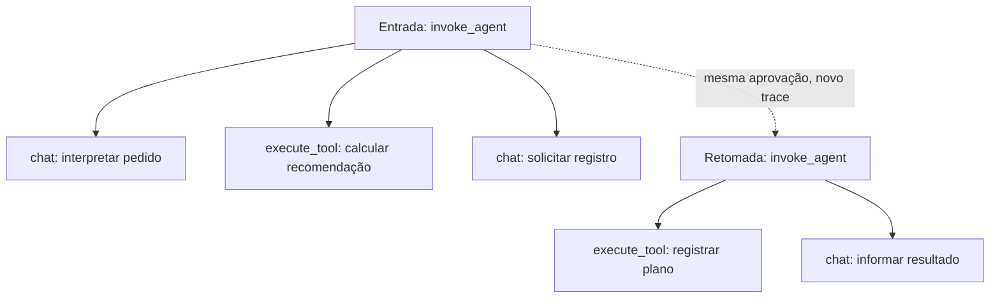

# Plano e resultados de observabilidade — Pastéis Miyata

A versão 1.0 do plano definiu os indicadores e seus objetivos antes da coleta.
Esta revisão documenta a instrumentação e os resultados medidos, sem alterar
as metas. A versão avaliada foi `obs-v1-9393b1db60fb`, na coorte `avaliacao`.

## 1. Perguntas de observabilidade

| Interessado | Pergunta | Sinal necessário | Decisão apoiada |
|---|---|---|---|
| Negócio | O agente termina com uma resposta utilizável ou devolve respostas degradadas? | SLI de qualidade, motivos de término, normalizações e erros técnicos | Manter o uso supervisionado ou recorrer ao processo manual enquanto se investiga uma degradação |
| Operação | A demora está no modelo, nas ferramentas ou na espera por aprovação? | p50 e p95 da raiz e dos spans filhos; intervalo de aprovação medido separadamente | Escolher qual componente investigar primeiro |
| Quem paga | Quanto custa cada execução e quantas ultrapassam o limiar definido? | Tokens, preços configurados e custo estimado por raiz | Avaliar se é preciso revisar o contexto, as chamadas repetidas ou os limites do agente |
| Quem responde pelo sistema | É possível explicar por que uma regra foi aplicada ou por que um plano foi registrado? | Documento recuperado, desfecho da ferramenta, versão do sistema e eventos de aprovação correlacionados | Localizar a evidência de uma decisão e investigar ações cuja autorização não possa ser demonstrada |

## 2. Trace de uma execução

Uma execução observada é uma chamada a `AgentePlanejamento.executar` ou a
`AgentePlanejamento.retomar`. Cada chamada produz uma raiz própria. Se o agente
pausa para aprovação, a raiz termina naquele momento. A retomada abre outro
trace, vinculado pelo mesmo `pasteis.aprovacao.id`. Assim, o tempo entre a
solicitação e a decisão não entra na latência do agente.

A árvore abaixo ilustra um fluxo possível para calcular e registrar um plano.
Ela descreve a instrumentação, não uma sequência obrigatória para todos os casos.

### Spans e pontos de instrumentação

| Span | Onde é gerado | O que registra |
|---|---|---|
| `invoke_agent pasteis-miyata` | Fachada do agente, em `src/agent.py` | Versão, tipo de execução, coorte, latência, motivo de término, estado da saída, custo e eventos de decisão |
| `chat <modelo>` | Em `src/graph.py`, quando há chamada ao provedor | Modelo solicitado, modelo retornado quando informado, tokens de entrada e saída, custo estimado e tipo de erro, sem copiar a mensagem da exceção |
| `execute_tool <ferramenta>` | No executor, nas rotas diretas do corpus e na tentativa de registro após aprovação | Nome, duração, argumentos e resultado selecionados, além do desfecho da chamada |

O módulo `src/observabilidade.py` implementa a exportação local. Uma rota
determinística pode ter uma raiz e um span de ferramenta, sem span de modelo.
Chamadas bloqueadas antes da execução são registradas como eventos; elas não
entram no denominador de ferramentas executadas. Uma pausa para aprovação
também não é uma tentativa de registro.

### Atributos da raiz

| Atributo | Uso |
|---|---|
| `pasteis.sistema.versao` e `service.version` | Identificam o código avaliado e separam medições de versões diferentes |
| `pasteis.modelo.configurado` | Identifica o modelo configurado sem pressupor que houve chamada |
| `pasteis.prompt.orquestrador.versao`, `pasteis.prompt.procedimento.versao` e respectivos hashes | Identificam os prompts sem copiar seu conteúdo; os hashes são registrados quando os prompts são carregados |
| `pasteis.execucao.tipo` e `pasteis.execucao.coorte` | Separam nova entrada de retomada e distinguem avaliação, operação e teste |
| `pasteis.execucao.motivo_termino` e `pasteis.execucao.categoria_termino` | Distinguem conclusão, pedido de informação, recusa, pausa, erro, limite e outras causas de término |
| `pasteis.execucao.latencia_ms` | Mede o processamento da chamada ao agente em milissegundos, sem incluir a espera por aprovação |
| `pasteis.execucao.custo_estimado_usd` e `pasteis.execucao.custo_completo` | Permitem calcular o custo observado sem tratar uso desconhecido como zero |
| `pasteis.execucao.erros_tecnicos`, `pasteis.saida.status`, `pasteis.saida.suficiente` e `pasteis.saida.normalizada` | Permitem distinguir um término utilizável de uma resposta degradada, mesmo quando há saída no formato esperado |
| `pasteis.aprovacao.id` | Vincula solicitação e decisão, inclusive quando a retomada usa um checkpoint persistido |

### Dados registrados e acesso

- O trace guarda campos estruturados da entrada e da saída, referências dos
  documentos recuperados, identificadores opacos e desfechos das ferramentas.
  Não copia prompts, texto operacional livre, credenciais ou linhas completas
  do MySQL.
- Os eventos `aprovacao.solicitada`, `aprovacao.decidida` e `aprovacao.escrita`,
  quando presentes, permitem localizar a proposta, a decisão e o desfecho da
  tentativa de registro. Eles não substituem a validação de autoridade no grafo.
- Os spans são exportados localmente em JSONL para `logs/traces/`, sem coletor
  remoto. O [guia de uso dos traces](uso_traces.md) mostra como consultar os
  arquivos. Os traces brutos ficam fora do Git.
- A retenção operacional de até 30 dias é uma proposta administrada localmente.
  Não há rotina de exclusão automática implementada.

### Demonstração da instrumentação

Na coorte `teste`, a pergunta controlada “Sobra zero prova que faltou produto?”
gerou o trace `0x76110b6575995578efcefaedef472852`. A raiz
`invoke_agent pasteis-miyata` teve um span filho `execute_tool buscar_conhecimento`.
O documento usado foi `glossario_dados_v1`, versão 1, e a saída registrou
`prova_falta=false`. Não houve chamada ao MySQL nem ao modelo.

Essa demonstração comprova que uma rota determinística gera trace. Ela não
integra os indicadores da coorte `avaliacao`.

## 3. Modos de falha

| Modo de falha | Tipo | Sinal que permite identificá-lo |
|---|---|---|
| O provedor do modelo falha ou excede o tempo esperado | Ruidosa | Span `chat` com `error.type` e raiz com motivo associado à falha do modelo |
| A ferramenta não consegue consultar o MySQL | Ruidosa | `pasteis.ferramenta.desfecho=erro_tecnico`, distinto de `sem_dados` |
| O agente esgota o orçamento de passos, tokens, tempo ou custo | Silenciosa para quem observa apenas exceções | `categoria_termino=orcamento_esgotado` e código `LIMITE_DE_*` |
| O modelo devolve JSON inválido e o agente normaliza a saída | Silenciosa para quem verifica apenas o formato final | `pasteis.saida.normalizada=true`, mesmo se a saída no contrato tiver status `concluido` |
| Uma aprovação não recebe decisão dentro do prazo | Silenciosa sem correlação dos eventos | Solicitação sem decisão correspondente após `pasteis.aprovacao.expira_em`, ou decisão de expiração registrada |

## 4. Objetivos e método de medição

| Objetivo | Meta definida antes da coleta | Janela e amostra mínima |
|---|---|---|
| Latência operacional | p95 de `pasteis.execucao.latencia_ms` ≤ 15.000 ms | Sete dias, mesma versão e coorte, com pelo menos 30 raízes medidas |
| Qualidade de término | SLI ≥ 95% | Sete dias, mesma versão e coorte, com pelo menos 30 execuções elegíveis |

### 4.1. Definição do SLI de qualidade

**Execuções válidas (`N`).** Raízes `invoke_agent` encerradas na janela, da mesma
versão e coorte. Excluem-se somente a pausa legítima
(`categoria_termino=aguardando_humano` acompanhada do evento
`aprovacao.solicitada`) e o cancelamento explícito (`interrompido`). Erros,
bloqueios, laços, limites esgotados e términos indeterminados continuam no
denominador.

**Execuções boas (`B`).** Entre as válidas, contam como boas:

- `respondeu` com `status=concluido` e `suficiente=true`;
- `pediu_esclarecimento` com `status=precisa_informacao`;
- `recusou` com `status=recusado`.

Para as três categorias, exige-se `normalizada=false` e `erros_tecnicos=0`.
Uma recusa ou um pedido de esclarecimento previsto pode ser um bom término.
O SLI não decide se todo conteúdo da resposta está correto; essa verificação
continua sendo responsabilidade da suíte de avaliação.

- **SLI de qualidade:** `100 × B / N`.
- **Orçamento de erro:** `5% × N`, com no máximo `floor(0,05 × N)` execuções
  ruins sem violar a meta.
- **Consumo do orçamento:** `100 × (N − B) / (0,05 × N)`.
- **Cobertura:** cada etapa executada no `resultado.json` deve ter uma raiz
  correspondente. Ausência ou duplicidade de trace invalida a conciliação.
  O leitor também confere os spans de modelo contra o contador de chamadas
  da raiz.

### 4.2. Coleta e cobertura

As duas rodadas executaram os mesmos 20 casos do dataset `1.0.0`, com o modelo
configurado `gpt-5.6-luna` e a versão `obs-v1-9393b1db60fb`. O MySQL local foi
usado em modo somente leitura, sobre o snapshot `c7f695afd8f7`, com 138
operações e 3.634 registros. O leitor confirmou a igualdade dos hashes
completos de código, dataset e snapshot das duas rodadas.

Os términos observados ocorreram em **18/11/2026, entre 21:51:10 e 21:56:40**,
no fuso de São Paulo. O relatório usa uma janela móvel de sete dias encerrada
no último término. As duas rodadas cabem nessa janela, mas a coleta observada
durou cerca de cinco minutos e meio: **não houve monitoramento contínuo por
sete dias**. Os carimbos dos arquivos estão em UTC, por isso mostram 19/11.

| Rodada | Casos aprovados pelo verificador | Etapas executadas | Raízes conciliadas |
|---|---:|---:|---:|
| 1 | 20/20 | 26 | 26 |
| 2 | 20/20 | 26 | 26 |
| **Total** | **40/40 avaliações dos mesmos 20 casos** | **52** | **52** |

Evidências:

- [Resultado da rodada 1](../evals/resultados/obs-v1-9393b1db60fb-20261119T005315581767Z/resultado.json)
- [Resultado da rodada 2](../evals/resultados/obs-v1-9393b1db60fb-20261119T005640561234Z/resultado.json)
- [Resumo conciliado e métricas por execução](../evals/resultados/obs-v1-9393b1db60fb-resumo.json), gerado por `scripts/resumir_traces.py`

### 4.3. Latência

Os percentis usam o posto mais próximo: após ordenar as observações, seleciona-se
a posição `ceil(p × N)`. A latência das raízes foi obtida de
`pasteis.execucao.latencia_ms`.

| Escopo | Execuções | p50 | p95 |
|---|---:|---:|---:|
| Todas as raízes | 52 | 2,729 s | **5,899 s** |
| Nova entrada | 46 | 3,400 s | 5,899 s |
| Retomada | 6 | 1,585 s | 2,281 s |

Comparação dos spans filhos observados:

| Span | Chamadas | p50 | p95 |
|---|---:|---:|---:|
| `chat` | 64 | 2.181,485 ms | 3.719,207 ms |
| `execute_tool` | 32 | 10,847 ms | 33,035 ms |

A espera entre solicitação e decisão foi medida em seis pares de eventos,
com p50 de **17,463 ms** e p95 de **18,641 ms**. Esses valores correspondem à
retomada pelo roteiro da suíte. Eles não estimam o tempo de decisão do
proprietário em operação e não entram na latência das raízes.

### 4.4. Custo por execução

As 64 chamadas ao modelo informaram uso: **243.901 tokens de entrada** e
**4.876 tokens de saída**. Com os preços configurados para a rodada
(US$ 0,20 por milhão de tokens de entrada e US$ 1,20 por milhão de saída),
o custo foi:

| Medida | Resultado |
|---|---:|
| Execuções com custo completo | 52/52 |
| Custo total estimado | **US$ 0,0546314** |
| Custo médio por execução | US$ 0,0010506038 |
| Maior custo em uma execução | US$ 0,0020364 |
| Execuções acima de US$ 0,01 | 0/52 |

Os valores são estimativas com base nos tokens e preços configurados, não
valores de fatura. O JSON de resumo guarda o custo de cada execução.
Chamadas sem modelo têm custo zero; uma retomada não volta a somar o custo
do trecho anterior à pausa.

### 4.5. Motivos de término e erros por ferramenta

Os percentuais abaixo usam as **52 raízes** como denominador, incluindo pausas.

| Motivo de término | Quantidade | Percentual |
|---|---:|---:|
| `CONCLUIDO` | 26 | 50,00% |
| `PRECISA_INFORMACAO` | 10 | 19,23% |
| `RECUSADO` | 10 | 19,23% |
| `AGUARDANDO_APROVACAO` | 6 | 11,54% |
| **Total** | **52** | **100,00%** |

A taxa por ferramenta usa somente spans `execute_tool` observados. O numerador
é o número de chamadas com `desfecho=erro_tecnico`. `sem_dados` é um desfecho
distinto de erro técnico.

| Ferramenta | Chamadas | `ok` | `sem_dados` | Erros técnicos | Taxa de erro |
|---|---:|---:|---:|---:|---:|
| `buscar_conhecimento` | 8 | 6 | 2 | 0 | 0,00% |
| `calcular_recomendacao` | 10 | 10 | 0 | 0 | 0,00% |
| `consultar_historico` | 4 | 4 | 0 | 0 | 0,00% |
| `consultar_operacao` | 4 | 2 | 2 | 0 | 0,00% |
| `registrar_plano` | 4 | 4 | 0 | 0 | 0,00% |
| `salvar_preferencia` | 2 | 2 | 0 | 0 | 0,00% |
| **Total** | **32** | **28** | **4** | **0** | **0,00%** |

### 4.6. Resultado dos SLOs

Para o SLI de qualidade, foram excluídas seis pausas legítimas e nenhum
cancelamento. Das 46 execuções elegíveis, 46 tiveram bom término. Não houve
normalização de saída nem erro técnico registrado nas raízes.

| Objetivo | Resultado medido | Situação na amostra |
|---|---|---|
| p95 ≤ 15 s, com pelo menos 30 raízes | **5,899 s**, em 52 raízes | Atingido |
| SLI ≥ 95%, com pelo menos 30 execuções elegíveis | **100% (46/46)** | Atingido |
| Consumo do orçamento de erro | **0%**: 0 execuções ruins; a amostra comportava até 2 sem violar a meta | Dentro do orçamento |

O resultado vale para a versão, a coorte, o snapshot e os cenários medidos.
Não representa disponibilidade em produção nem comprova o desempenho do
agente em situações não cobertas pela suíte.

### 4.7. Respostas às quatro perguntas

1. **Negócio.** O agente terminou de forma utilizável nas 46 execuções
   elegíveis. Foram 26 conclusões, 10 pedidos de informação e 10 recusas,
   sem normalização de saída. A evidência sustenta manter o uso supervisionado
   nos cenários avaliados. Ela não significa que todo pedido gerou um plano.
2. **Operação.** Os spans de modelo apresentaram latências maiores que os
   spans de ferramenta: p95 de 3,719 s no `chat` contra 33,035 ms nas
   ferramentas. Em caso de lentidão, vale investigar primeiro as chamadas ao
   modelo e confirmar no trace da execução afetada. A espera pela aprovação
   fica fora dessa comparação.
3. **Quem paga.** A coleta custou aproximadamente US$ 0,0546, com média de
   US$ 0,00105 por execução. Nenhuma execução atingiu o limiar de alerta de
   US$ 0,01. Os valores por execução estão no relatório para localizar casos
   mais caros antes de alterar orçamento ou contexto.
4. **Quem responde pelo sistema.** Foram encontrados seis pares de solicitação
   e decisão, sem eventos de aprovação sem correspondência, e quatro chamadas
   de registro com desfecho `ok`. Uma chamada bem-sucedida pode ser idempotente,
   portanto isso não equivale a quatro novas gravações. O agregado também não
   prova por que uma recusa específica aconteceu. Para isso, é necessário
   inspecionar no trace individual o documento aplicado, ou a aprovação e a
   tentativa de escrita vinculadas àquele plano. Essa reconstrução deve constar
   no campo **Registro e retenção** de `docs/model-card.md`.

## 5. Alertas e resposta operacional

| Sinal | Condição de atenção | Observado na coleta | Ação quando ocorrer |
|---|---|---|---|
| Custo por execução | Custo estimado superior a US$ 0,01 | Nenhuma ocorrência | Conferir tokens e chamadas repetidas antes de ampliar o orçamento |
| Degradação silenciosa | SLI abaixo de 95% com amostra e cobertura suficientes | Não ocorreu: SLI de 100% | Examinar traces de limite, laço ou normalização antes de promover a versão |
| Latência | p95 acima de 15 s com pelo menos 30 raízes | Não ocorreu: p95 de 5,899 s | Comparar spans de modelo e ferramentas nos casos lentos |
| Aprovação pendente | Prazo encerrado sem decisão correspondente | Nenhuma solicitação sem decisão medida | Conferir a pendência com o proprietário, sem aprovar nem reexecutar automaticamente |

Esses sinais são consultados no relatório local. Não há serviço de alerta
contínuo, notificação automática nem decisão humana automatizada.

## Referências

- [Modelo de plano de observabilidade — Aula 15](https://github.com/celsocrivelaro/senac-agentes-llm/blob/main/aula-15-mlops-observabilidade/exercicios/modelo-plano-de-observabilidade.md)
- [Convenções GenAI do OpenTelemetry: agente](https://github.com/open-telemetry/semantic-conventions-genai/blob/main/docs/gen-ai/gen-ai-agent-spans.md), [inferência](https://github.com/open-telemetry/semantic-conventions-genai/blob/main/docs/gen-ai/client-inference.md) e [ferramentas](https://github.com/open-telemetry/semantic-conventions-genai/blob/main/docs/gen-ai/execute-tool.md)